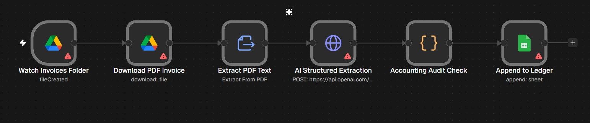
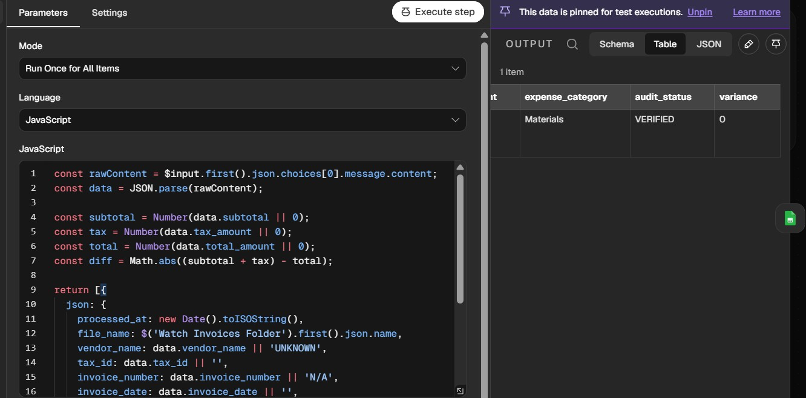

# n8n Automated Invoice OCR & Accounting Math Audit (Google Sheets)

Turnkey **n8n automation workflow** that monitors a Google Drive folder for incoming PDF invoices, extracts structured accounting fields via **GPT-4o-mini**, executes an automated JavaScript mathematical audit (`Subtotal + Tax = Total`), and logs verified entries directly into **Google Sheets**.

### [Download Production Workflow (.json) & Setup Kit ($29 USD)](https://payhip.com/b/tzei5)

---

## Architecture Overview



1. **Watch Invoices Folder (Google Drive Trigger):** Polls a designated folder for newly uploaded PDF invoices.
2. **Download PDF Invoice:** Retrieves the binary file securely.
3. **Extract PDF Text:** Parses raw text from text-based PDFs without external OCR dependencies.
4. **AI Structured Extraction (OpenAI GPT-4o-mini):** Enforces strict JSON schema output at `temperature: 0` (~$0.0005 USD per invoice).
5. **Accounting Audit Check (JavaScript Code Node):** Validates line-item arithmetic (`Math.abs((subtotal + tax) - total) <= 0.01`) and flags entries as `VERIFIED`, `MATH_DISCREPANCY`, or `NEEDS_REVIEW`.
6. **Append to Ledger (Google Sheets):** Auto-maps all 13 audited fields into a structured ledger tab.

### v1.1 Audit Guard (`Accounting Audit Check`)

```javascript
const rawPdfText = ($('Extract PDF Text').first().json.text || '').trim();
const subtotal = Number(data.subtotal) || 0;
const tax = Number(data.tax_amount) || 0;
const total = Number(data.total_amount) || 0;
const invoiceNumber = (data.invoice_number || '').toString().trim();

const variance = Number(Math.abs((subtotal + tax) - total).toFixed(2));
const hasReadableText = rawPdfText.length >= 15;
const hasValidCoreFields = total > 0 && invoiceNumber.length > 0;

let auditStatus = 'VERIFIED';
if (!hasReadableText || !hasValidCoreFields) {
  auditStatus = 'NEEDS_REVIEW';
} else if (variance > 0.01) {
  auditStatus = 'DISCREPANCY';
}
```

## Automated Audit Output



### Extracted & Audited Schema
| Field | Type | Description |
| :--- | :--- | :--- |
| `processed_at` | ISO Timestamp | Exact execution timestamp |
| `file_name` | String | Source PDF filename |
| `vendor_name` | String | Legal or trade name of the supplier |
| `tax_id` | String | Business / Tax registration number (GST/HST, EIN, VAT, RUT) |
| `invoice_number` | String | Unique document identifier |
| `invoice_date` | YYYY-MM-DD | Standardized invoice date |
| `currency` | ISO 4217 | 3-letter currency code (USD, CAD, EUR, CLP) |
| `subtotal` | Float | Pre-tax net amount |
| `tax_amount` | Float | Total tax charged |
| `total_amount` | Float | Final invoice total |
| `expense_category` | String | Auto-classified (`Materials`, `Subcontractors`, `Software`, `Fuel`, `Office`, `Utilities`, `Other`) |
| `audit_status` | String | `VERIFIED` or `MATH_DISCREPANCY` |
| `variance` | Float | Absolute mathematical difference detected |

## What's Included in the Kit
* `invoice-ocr-ledger-n8n.json` — Ready-to-import 6-node workflow.
* `Ledger_Template.csv` — Pre-formatted Google Sheets header template.
* `Setup_Guide.pdf` — Step-by-step credential and deployment instructions.

### [Get Instant Access on Payhip ($29 USD)](https://payhip.com/b/tzei5)
